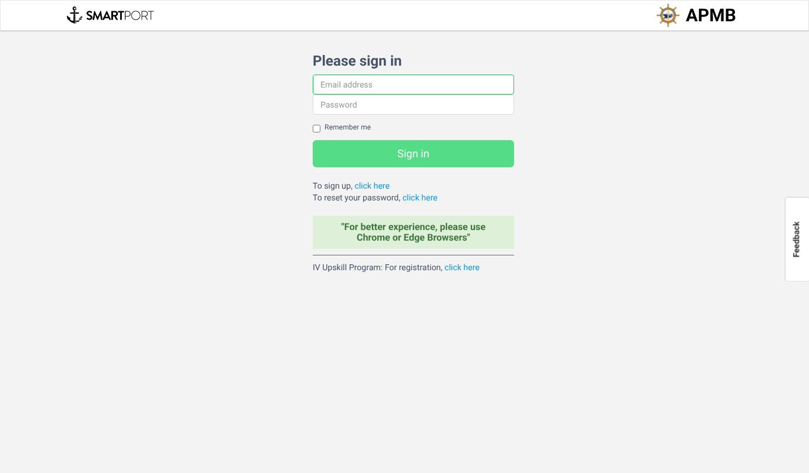
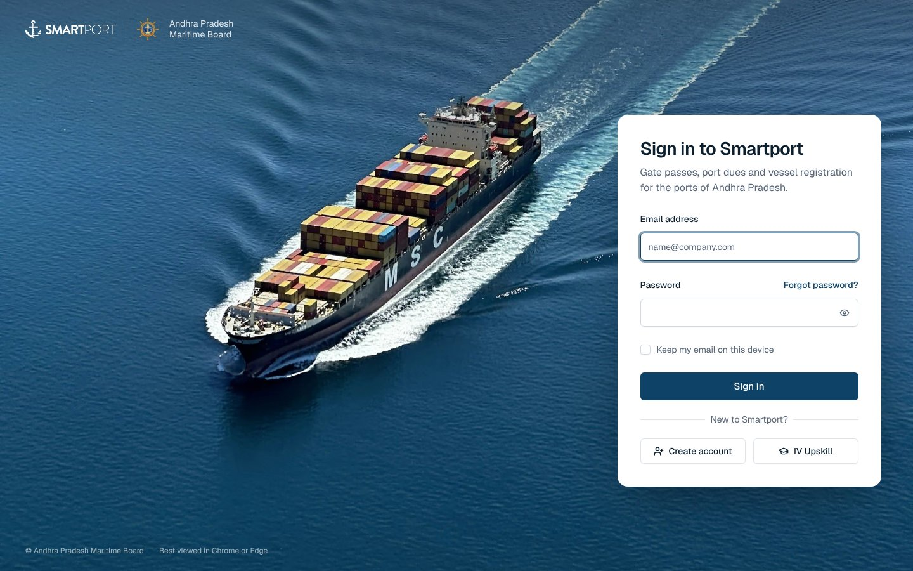

# volteo-landing-login
smartport login pane re-design

A redesigned, minimal login page for [Smartport](https://smartport.ap.gov.in), written in
plain HTML, CSS and JavaScript. No framework, no build step, no runtime dependencies.

**Live preview:** https://job-one-lilac.vercel.app (sign-in is disabled outside smartport.ap.gov.in)

| Before | After |
| --- | --- |
|  |  |

## Getting started

There is nothing to build. Open the folder with any static web server:

```bash
npx serve .                      # or: python3 -m http.server 8000
```

Then open the address it prints. Opening `index.html` directly from disk also
works for checking the design.

Only needed when you replace an image:

```bash
npm install      # installs sharp (image tool), nothing else
npm run images   # regenerate the optimised images from images-src/
```

## Project structure

```
index.html                The page: photo, sign-in card, footer
css/styles.css            All styles: colours, layout, form controls, breakpoints
js/login.js               Behaviour: show/hide password, remember email, sign-in
img/                      Optimised images generated from images-src/ (do not edit by hand)
fonts/geist-latin.woff2   Geist font, self-hosted (licence in fonts/GEIST-LICENSE.txt)
favicon.png               Browser tab icon
images-src/               Original images (edit these, then run `npm run images`)
tools/optimize-images.mjs Makes the AVIF/WebP sizes of the photo, the emblem and favicon
```

Where to change things:

- **URLs, links, localStorage keys:** the "Settings" block at the top of `js/login.js`.
- **Colours, radius:** the CSS variables in `:root` at the top of `css/styles.css`.
- **Text and logos:** `index.html`.

## How login works

1. The form's submit handler in `js/login.js` calls `login(email, password)`.
2. `login` POSTs to `/api/authenticate` and stores the returned token in
   `localStorage["token"]`.
3. It then loads the profile from `/api/user/me` (sending the token in the
   `x-access-token` header) and stores it in `localStorage["splogu"]`.
4. The user is redirected to the main app, or to the password reset page if
   `password_reset_flag` is set.

The storage keys match what the existing Smartport app reads, so the user stays
logged in after the redirect. If you change them, update `STORAGE_KEYS` in
`js/login.js`.

The API calls use relative URLs (`/api/...`), so the page has to be served
from the same domain as the Smartport API to sign in for real. A plain local
server has no `/api`, so on `localhost` a sign-in attempt shows an error;
everything else (validation, password toggle, remember email) works.

Sign-in only runs on `smartport.ap.gov.in` (and `localhost` for development).
On any other address, such as the Vercel preview, the page shows a
"Design preview" note and never sends credentials. See `IS_DESIGN_PREVIEW`
in `js/login.js`.

## Deployment

The site deploys on Vercel as static files. `vercel.json` turns off the
install and build steps and sets cache headers; `.vercelignore` keeps the
source images, tools and docs out of the deployment. Once the repo is
connected to the Vercel project, every push to `main` redeploys automatically.

On any other host, upload `index.html`, `favicon.png` and the `css/`, `js/`,
`img/` and `fonts/` folders.

## Performance

Lighthouse (the engine behind PageSpeed Insights):

| | Performance | Accessibility | Best practices | SEO | LCP | Page weight |
| --- | --- | --- | --- | --- | --- | --- |
| Mobile | 99 | 100 | 100 | 100 | 1.8 s | 130 KB |
| Desktop | 100 | 100 | 100 | 100 | 0.4 s | 155 KB |

What makes it fast:

- **No framework.** The HTML is the page, so it shows as soon as it arrives.
  The only script (`js/login.js`, about 6 KB) loads with `defer` and only adds
  behaviour.
- **Right-sized photo.** The background photo is served as AVIF (or WebP) at
  five widths, and the browser downloads only the size it needs: about 20 to
  90 KB instead of 515 KB. It is preloaded in `index.html` with high priority.
- **Self-hosted font.** Geist is served from this site (no Google Fonts
  request) and preloaded.
- **Caching.** The font is cached for a year, images for a week (`vercel.json`).
- **Smooth animation.** The background drift only moves the image (a GPU
  transform), so there is no repainting or layout work while it runs.

If you change the photo: put the original in `images-src/`, run
`npm run images`, and keep the widths and `sizes` in the `<picture>` and the
preload in `index.html` in sync.

## Design notes

- The whole page is a photo of a container ship at sea, seen from above.
  The white sign-in card floats on the open water: to the right of the ship
  on large screens, below it on phones and tablets. On phones and tablets the
  photo is shown at full width so the whole ship stays visible, then fades
  into the same deep-sea blue as the page.
- The photo drifts very slowly toward the ship's heading (40 seconds each
  way). It stays still for visitors who have "reduce motion" turned on.
  The animation is `drift` in `css/styles.css`.
- Colours come from the photo: **deep-sea blue** (`#0e4266`) for buttons and
  links, the **open water** (`#0b3a54`) behind the photo, and a dark ink
  (`#0c1f2e`) for text.
- Font: [Geist](https://vercel.com/font) (SIL Open Font License).
- Always light: the card stays white even if the visitor's device is in dark
  mode (`color-scheme: light`, no dark-mode styles).
- Icons are inline SVGs from [Lucide](https://lucide.dev) (ISC licence).

## What changed from the old page

- Sign-in card floating on a full-page photo of a container ship at sea
- Visible labels instead of placeholder-only fields
- Show/Hide password toggle (eye icon)
- "Forgot password?" next to the password field; "Create account" below the button
- "Keep my email on this device" actually remembers the email
- Clear error messages and a "Signing in…" state while waiting
- Responsive on phones, tablets, laptops and large screens

## Photo credit

`images-src/container-ship.jpg` (and the sizes generated from it in `img/`) is
[MSC Lisa in Port Phillip Bay](https://unsplash.com/photos/ZT3i-6XW8J8)
by Haydn, free to use under the [Unsplash License](https://unsplash.com/license)
(no credit required). Any stock photo with open water on one side works; keep
the ship on the left so the card has room on the right.

## License

[MIT](LICENSE)
