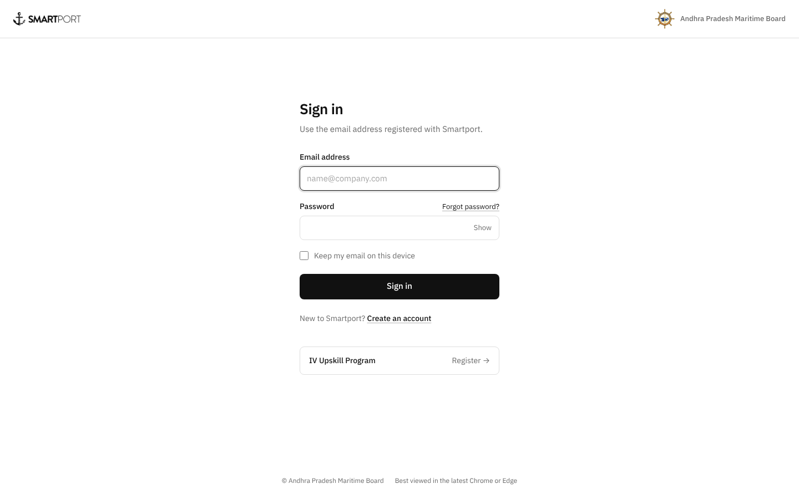

# volteo-landing-login
smartport login pane re-design

A redesigned, minimal login page for [Smartport](https://smartport.ap.gov.in), built with React + Vite.

**Live preview:** https://job-one-lilac.vercel.app (sign-in is disabled outside smartport.ap.gov.in)

| Before | After |
| --- | --- |
|  |  |

## Getting started

```bash
npm install
npm run dev      # start local dev server at http://localhost:5173
npm run build    # production build into dist/
npm run preview  # serve the production build locally
```

During development, requests to `/api/*` are proxied to `https://smartport.ap.gov.in`
(see `vite.config.js`), so you can log in with a real account locally.

## Project structure

```
public/img/               Official logos (Smartport wordmark, APMB emblem)
src/
  main.jsx                Entry point: mounts <App /> and loads styles
  App.jsx                 Page layout: Header, LoginForm, Footer
  config.js               URLs, localStorage keys and logo paths (edit here first)
  styles.css              All styles; colors/sizes are CSS variables at the top
  components/
    Header.jsx            Slim top bar with the Smartport and APMB logos
    LoginForm.jsx         The sign-in form: fields, validation, submit
    Footer.jsx            Copyright and browser note
  services/
    auth.js               API calls: login() and logout()
```

## How login works

1. `LoginForm` calls `login(email, password)` from `services/auth.js`.
2. `login` POSTs to `/api/authenticate` and stores the returned token in
   `localStorage["token"]`.
3. It then loads the profile from `/api/user/me` (sending the token in the
   `x-access-token` header) and stores it in `localStorage["splogu"]`.
4. The user is redirected to the main app, or to the password reset page if
   `password_reset_flag` is set.

The storage keys match what the existing Smartport app reads, so the user stays
logged in after the redirect. If you change them, update `STORAGE_KEYS` in
`src/config.js`.

Sign-in only runs on `smartport.ap.gov.in` (and `localhost` for development).
On any other address, such as the Vercel preview, the page shows a
"Design preview" note and never sends credentials. See `IS_DESIGN_PREVIEW`
in `src/config.js`.

## Design notes

- Monochrome on purpose: white page, near-black text and button, so the
  Smartport and APMB logos are the only colour. All colours are CSS
  variables at the top of `src/styles.css`.
- Font: IBM Plex Sans (loaded from Google Fonts in `index.html`).
- Always light: the page stays white even if the visitor's device is in dark mode.
- In production, React is loaded from jsDelivr via an import map (see
  `vite.config.js`), so the built bundle is only our own ~5 KB of code.
- Logo paths can be overridden at build time with `VITE_SMARTPORT_LOGO_URL`
  and `VITE_APMB_LOGO_URL`.

## What changed from the old page

- Single centred form under a slim header with both official logos
- Visible labels instead of placeholder-only fields
- Show/Hide password toggle
- "Forgot password?" next to the password field; "Create an account" below the button
- "Keep my email on this device" actually remembers the email
- Clear error messages and a "Signing in…" state while waiting
- Responsive on mobile; consistent colours defined as CSS variables

## License

[MIT](LICENSE)
